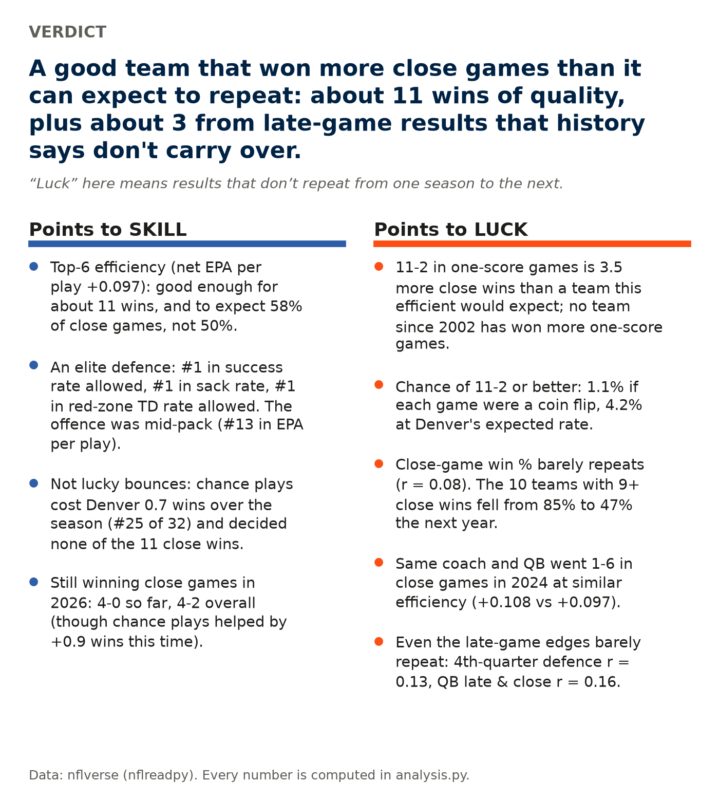
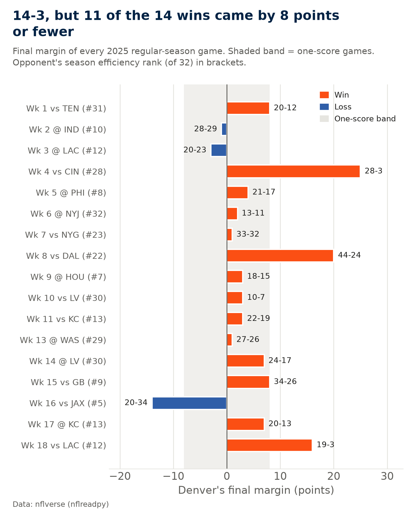
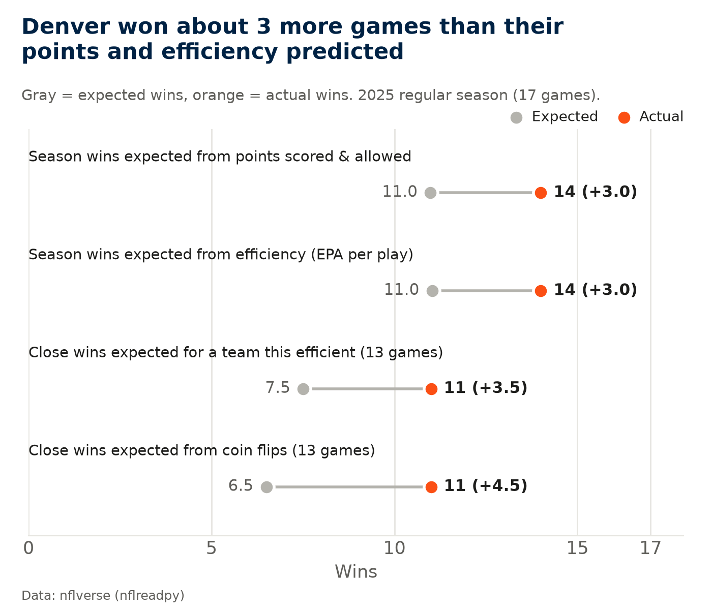
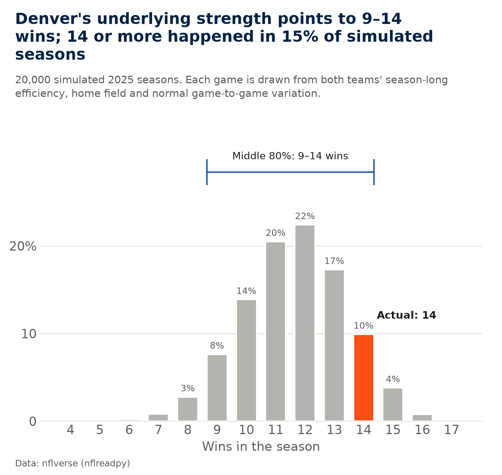
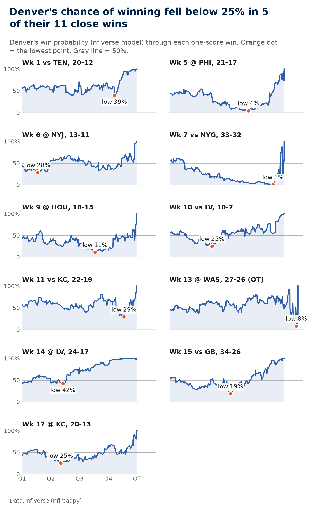
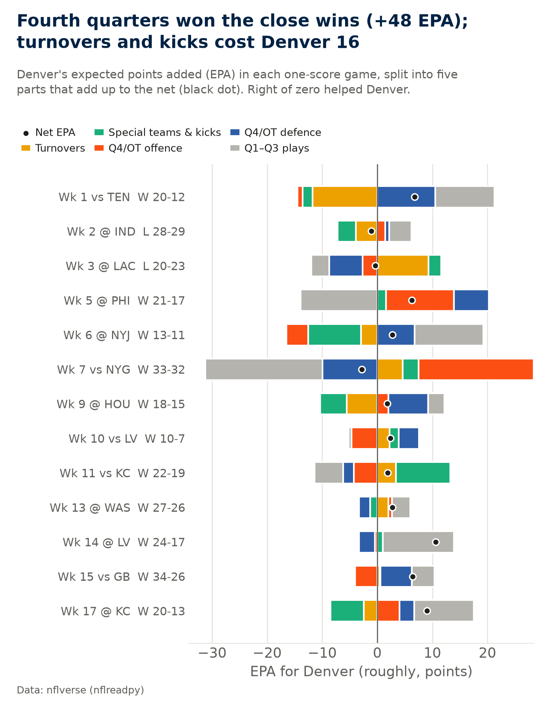
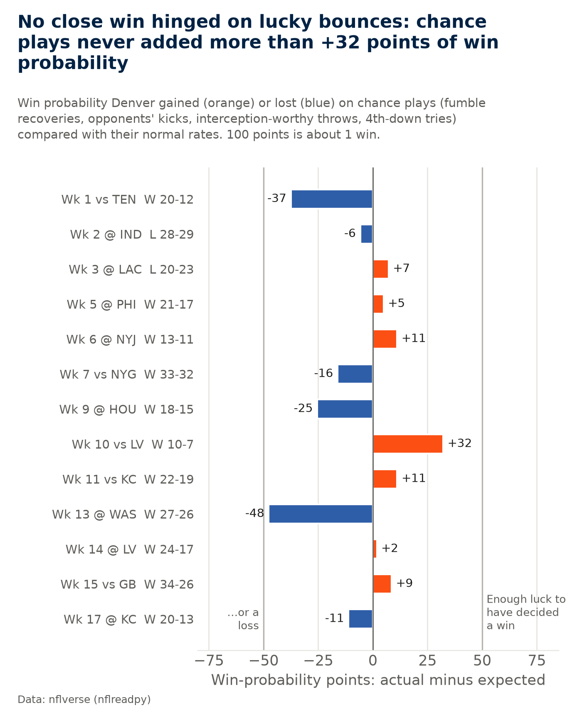
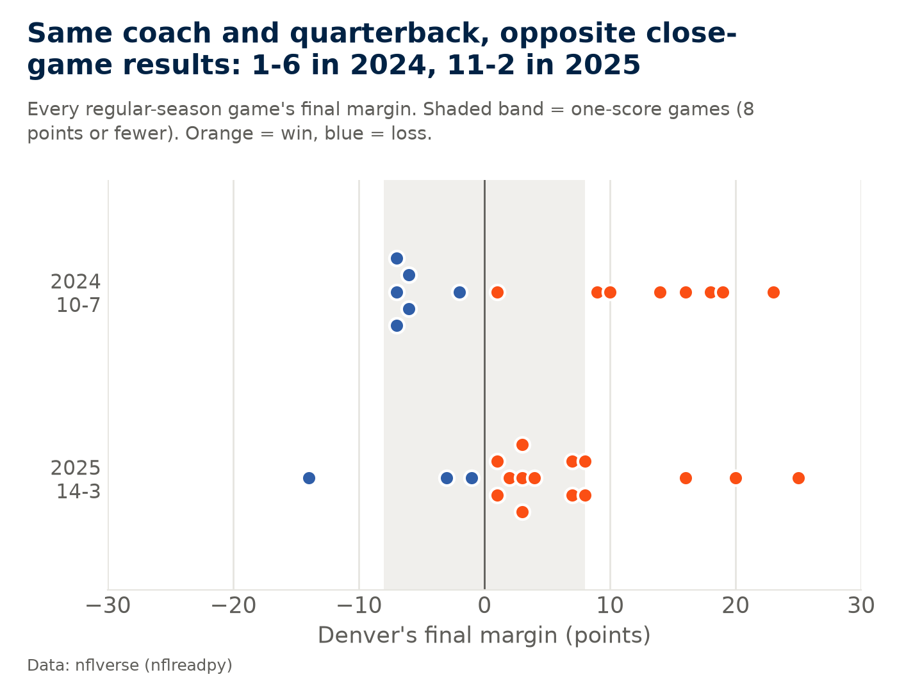
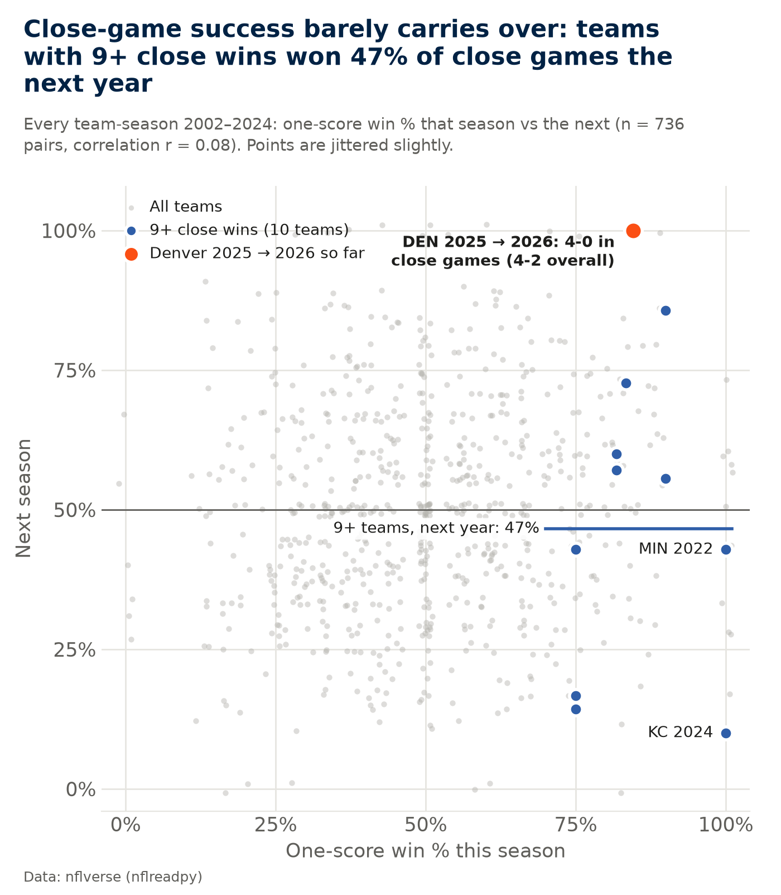
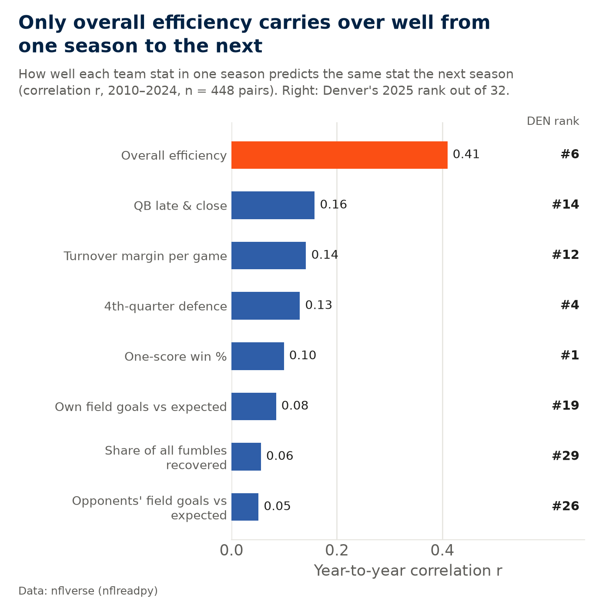

# Broncos 2025: luck or skill?

A retrospective of the 2025 Denver Broncos, who went 14-3 with an 11-2 record in one-score games (decided by
8 points or fewer). **How much of Denver's 2025 success was repeatable team quality, how much was close-game
execution, and what does that tell us about their true level heading into 2026?**

This project answers that with public NFL data only ([nflverse](https://github.com/nflverse), via the
`nflreadpy` Python package). Every number below is computed by one script, [`analysis.py`](analysis.py).

**Web page with the charts and a short write-up:** https://insul4rity.github.io/sports-analytics/broncos-luck-or-skill/

## Approach

1. **The season:** all 17 games with margin, opponent strength and Denver's efficiency in each, and an
   offence-versus-defence breakdown (EPA, success rate, passing/rushing, sacks, QB hits, explosive plays,
   third downs, red zone).
2. **Expected wins, with ranges:** Pythagorean expectation, an efficiency model and a game-by-game simulation,
   each with an 80% range rather than a single number, plus a binomial check of the 11-2 record.
3. **The close games:** win-probability timelines, what decided each one, and four models of Denver's expected
   close-game record (efficiency, opponent strength, home field, and previous-season late-game play).
4. **High-leverage luck:** for plays that are mostly chance (fumble recoveries, opponents' kicks,
   interception-worthy throws, 4th-down tries), luck = actual − expected change in win probability, plus a
   simulation of the close games with those plays redrawn at normal rates.
5. **Comparisons:** Denver 2024 vs 2025, every team since 2002 with 9+ close wins, and the 10 teams whose whole
   profile most resembles Denver 2025.
6. **Playoffs and 2026:** the two playoff games, and Denver's 2026 record so far as a live check.
7. **Robustness:** other close-game definitions, other historical periods, rolling out-of-sample forecasts and
   other model specifications, ending with a confidence scorecard.

## Findings

<!-- FINDINGS:START -->
*Generated by `analysis.py` from nflverse data: 2026 season through week 6 (last game 19 Oct 2026); data pulled 21 Oct 2026. Web page: https://insul4rity.github.io/sports-analytics/broncos-luck-or-skill/*

### The short answer

**A good team that won more close games than it can expect to repeat: about 11 wins of quality, plus about 3 from late-game results that history says don't carry over.**

**Repeatable quality:** an elite defence (#1 in success rate allowed, #1 in sack rate) and a mid-pack offence (#13 in EPA per play) made Denver 6th of 32 in efficiency: roughly an 11-win team, with a plausible range of 9–14. **Close-game execution:** 11-2 in one-score games, 3.5 wins more than a team this efficient would expect, earned in fourth quarters rather than through lucky bounces. **Heading into 2026:** the 10 most similar teams since 2010 averaged 9.7 wins the following year, and 9 of 10 won fewer games.

**What “luck” means here:** results that don't repeat from one season to the next. It doesn't mean the players did nothing right; winning a fourth quarter takes real plays. Section 9 measures the narrowest kind of luck, chance plays such as fumble recoveries and missed kicks, and those actually went against Denver.



### 0. Checking the starting figures

Before any analysis, every figure in the question was recomputed from nflverse schedules. A one-score game is one decided by 8 points or fewer (regular season; playoffs reported separately; a tie would count as half a win). All figures match.

| Figure | Stated | From the data | Match |
|---|---|---|---|
| 2025 regular-season record | 14-3 | 14-3 | yes |
| 2025 one-score record (8 points or fewer) | 11-2 | 11-2 | yes |
| 2025 point differential | +90 | +90 | yes |
| Divisional round vs Buffalo | W 33-30 | W 33-30 | yes |
| AFC Championship vs New England | L 10-7 | L 10-7 | yes |
| 2026 record so far | 4-2 | 4-2 | yes |
| 2026 one-score record so far | 4-0 | 4-0 | yes |

### 1. The 2025 season, game by game

Denver went 14-3. **11 of the 14 wins came by 8 points or fewer**; only 3 were by more (Wk 4 vs CIN by 25, Wk 8 vs DAL by 20, Wk 18 vs LAC by 16). The losses were by 1, 3, 14 points.

Opponent quality is measured by each opponent's 2025 net EPA per play (rank of 32). Against the top half of the league Denver went 6-3; against the bottom half, 8-0.

Per play, Denver out-played their opponent in 13 of 17 games. They were out-played in 4 and still won 2 of those (Wk 7 vs NYG, Wk 11 vs KC). Those are the wins least likely to repeat.

*How to read the chart:* each bar is one game's final margin, orange for wins and blue for losses. Bars that end inside the shaded band were one-score games.



| Game | Opp. rank | Result | One-score | DEN net EPA/play | Opp. net EPA/play |
|---|---|---|---|---|---|
| Wk 1 vs TEN | #31 | W 20-12 | yes | +0.283 | -0.252 |
| Wk 2 @ IND | #10 | L 28-29 | yes | +0.096 | +0.064 |
| Wk 3 @ LAC | #12 | L 20-23 | yes | -0.115 | +0.061 |
| Wk 4 vs CIN | #28 | W 28-3 |  | +0.405 | -0.113 |
| Wk 5 @ PHI | #8 | W 21-17 | yes | +0.026 | +0.083 |
| Wk 6 @ NYJ | #32 | W 13-11 | yes | +0.273 | -0.271 |
| Wk 7 vs NYG | #23 | W 33-32 | yes | -0.121 | -0.055 |
| Wk 8 vs DAL | #22 | W 44-24 |  | +0.297 | -0.051 |
| Wk 9 @ HOU | #7 | W 18-15 | yes | +0.080 | +0.097 |
| Wk 10 vs LV | #30 | W 10-7 | yes | +0.087 | -0.220 |
| Wk 11 vs KC | #13 | W 22-19 | yes | -0.103 | +0.050 |
| Wk 13 @ WAS | #29 | W 27-26 | yes | +0.064 | -0.118 |
| Wk 14 @ LV | #30 | W 24-17 | yes | +0.133 | -0.220 |
| Wk 15 vs GB | #9 | W 34-26 | yes | +0.121 | +0.082 |
| Wk 16 vs JAX | #5 | L 20-34 |  | -0.145 | +0.117 |
| Wk 17 @ KC | #13 | W 20-13 | yes | +0.237 | +0.050 |
| Wk 18 vs LAC | #12 | W 19-3 |  | +0.227 | +0.061 |

### 2. Where the quality came from: defence first

Ranking 6th in net efficiency hides a lopsided team. **The defence was elite:** #1 in success rate allowed, #1 in sack rate, #1 in QB-hit rate, #1 in red-zone touchdowns allowed and #2 in explosive plays allowed. **The offence was mid-pack:** #13 in EPA per play, #11 passing and #18 rushing, though it protected the quarterback well (#1 for fewest sacks per dropback).

The same split shows up in 2024, when the defence was #1 in EPA allowed and the offence #16. So the repeatable core of this team is its defence, and defensive efficiency is the kind of quality that tends to carry over.

**Which side delivered the close wins?** Across the 11 close wins, fourth-quarter and overtime defence added +26.1 EPA and the offence +21.6, so both sides contributed, the defence slightly more.

Definitions: success rate = share of plays with positive EPA; explosive = passes of 20+ yards or runs of 10+; red-zone rate = drives reaching the opponent's 20 that end in a touchdown. Pressure rate isn't in nflverse's play-by-play, so QB-hit rate stands in for it.

| Side | Stat | 2025 (rank) | 2024 (rank) | League avg 2025 |
|---|---|---|---|---|
| Offence | EPA per play | +0.037 (#13) | +0.010 (#16) | +0.014 |
| Offence | Success rate | 43.8% (#18) | 42.8% (#18) | 44.3% |
| Offence | Pass EPA per dropback | +0.101 (#11) | +0.060 (#17) | +0.063 |
| Offence | Rush EPA per carry | -0.071 (#18) | -0.075 (#17) | -0.063 |
| Offence | Sack rate (sacks per dropback) | 3.4% (#1) | 3.7% (#2) | 6.5% |
| Offence | Explosive play rate | 8.0% (#20) | 9.0% (#15) | 8.5% |
| Offence | 3rd-down conversion | 41.2% (#11) | 39.6% (#13) | 39.5% |
| Offence | Red-zone TD rate (drives) | 62.1% (#11) | 62.1% (#9) | 58.1% |
| Defence | EPA allowed per play | -0.060 (#8) | -0.098 (#1) | +0.014 |
| Defence | Success rate allowed | 37.7% (#1) | 40.4% (#3) | 44.3% |
| Defence | Pass EPA allowed per dropback | -0.037 (#9) | -0.059 (#1) | +0.063 |
| Defence | Rush EPA allowed per carry | -0.105 (#8) | -0.175 (#3) | -0.061 |
| Defence | Sack rate (sacks per dropback) | 9.8% (#1) | 8.9% (#1) | 6.5% |
| Defence | QB-hit rate (per dropback) | 21.4% (#1) | 19.0% (#1) | 14.6% |
| Defence | Explosive plays allowed | 5.7% (#2) | 7.0% (#2) | 8.5% |
| Defence | 3rd-down conversions allowed | 33.8% (#2) | 37.3% (#11) | 39.6% |
| Defence | Red-zone TD rate allowed | 43.1% (#1) | 50.0% (#4) | 58.2% |

### 3. Denver won about 3 more games than expected

There are two standard ways to estimate how many games a team should have won. **From points**, using the Pythagorean formula (points scored^2.37 ÷ (scored^2.37 + allowed^2.37)): a team that scores 401 and allows 311 usually wins **11.0** of 17. **From efficiency**: a straight-line fit of win % on net EPA per play (offence minus defence) across 480 team-seasons from 2010 to 2024 (R² = 0.78) gives **11.0**.

Denver won 14, which is **+3.0** above the points estimate and **+3.0** above the efficiency estimate. That was the largest gap in the league in 2025. Their efficiency ranked 6th, so the team was good; the record just ran ahead of how they played.

**Checking the 2.37.** 2.37 is the standard NFL exponent (from Daryl Morey's original work), not one fitted here. Testing every exponent from 1.5 to 3.5 on the same 480 team-seasons, the best fit is **2.78** (typical error 1.37 wins per season, vs 1.42 for 2.37). With 2.78, Denver's expected wins rise to 11.4, so they still won about 3 more than their points predicted. Any exponent from 2 to 3 gives 10.6–11.6 expected wins, so the finding doesn't depend on this choice.

**Close games.** Fitting one-score win % on net EPA per play (same team-seasons, 4,060 one-score games, weighted by games played) shows that a team as efficient as Denver typically wins **58%** of close games. That is better than 50%, but efficiency explains only a small part of close results (R² = 0.19). That means 7.5 expected close wins out of 13. Denver won 11: **+3.5 above expectation**.

*How to read the chart:* each row is one estimate. The gray dot is what was expected, the orange dot is what happened, and the gap between them is what efficiency can't explain.



### 4. How sure is “about 11 wins”?

11 expected wins is a point estimate, not proof that Denver were exactly an 11-win team. Three ways to put a range on it:

**Points:** even a team that truly wins 65% of its games (its Pythagorean rate) finishes anywhere from 8 to 13 wins in 80% of 17-game seasons. **Efficiency:** the regression misses by about 1.5 wins per team-season, which gives an 80% range of 9.1–13.0. **Game by game:** each of Denver's 17 games is simulated from both teams' season-long efficiency and home field (fitted on 3,903 games, 2010–2024: a 0.1 gap in net EPA per play is worth about 5.0 points of margin, home field about 2.0, and results scatter by about 12 points around that).

All three agree: **Denver's underlying level was roughly 9 to 14 wins**, and 14 sits at the top end, reached in 15% of simulated seasons. The game-by-game simulation is a little higher (11.6) than the other two because it accounts for Denver's schedule, which included several weak opponents.

*How to read the chart:* each bar is the share of simulated seasons ending with that many wins. The orange bar is what actually happened.



| Method | Expected wins | Middle 80% | Chance of 14+ |
|---|---|---|---|
| From points (Pythagorean) | 11.0 | 8–13 | 9.6% |
| From efficiency (regression) | 11.0 | 9.1–13.0 | 5.3% |
| Game-by-game simulation | 11.6 | 9–14 | 14.5% |

### 5. How unlikely is 11-2?

If every one-score game were a 50/50 coin flip, the chance of winning 11 or more of 13 is **1.1%** (about 1 in 89). At Denver's efficiency-based rate of 58% per game, it is **4.2%** (about 1 in 24).

That is rare for any one team, but with 32 teams every season, someone usually ends up with an unusual close-game record. Since 2002, 3 of 768 team-seasons won 11 or more one-score games. Denver 2025 is one of them, and nobody won more. The others: MIN 2022 (11-0 in close games) went 6-8 in close games and 7-10 overall the next year; KC 2024 (11-0 in close games) went 1-9 in close games and 6-11 overall the next year.

In plain words: even for a good team, 11-2 in close games is unusual. That is the first sign that something other than skill was involved.

### 6. The 11 close wins, one by one

Win probability is nflverse's play-by-play estimate of each team's chance of winning, based on the score, time left, field position, down and distance. In **5 of the 11 close wins** Denver's chance fell below 25% at some point, and in 3 it fell below 10% (Wk 5 @ PHI at 4%, Wk 7 vs NYG at 1%, Wk 13 @ WAS at 8%).

*How to read the chart:* the line is Denver's chance of winning from kick-off to the final whistle. A line that dips far below the gray 50% mark and still finishes at 100% is a comeback.

The two playoff games are covered separately in section 14.



| Game | Result | Low win % | TO margin | Q4 off EPA | Q4 def EPA | Luck (WP pts) |
|---|---|---|---|---|---|---|
| Wk 1 vs TEN | W 20-12 | 39% | 0 | -1.0 | +10.5 | -37 |
| Wk 2 @ IND | L 28-29 | 0% | -1 | +1.4 | +0.8 | -6 |
| Wk 3 @ LAC | L 20-23 | 0% | +2 | -2.7 | -6.0 | +7 |
| Wk 5 @ PHI | W 21-17 | 4% | 0 | +12.3 | +6.3 | +5 |
| Wk 6 @ NYJ | W 13-11 | 28% | -1 | -4.0 | +6.8 | +11 |
| Wk 7 vs NYG | W 33-32 | 1% | +1 | +20.9 | -9.9 | -16 |
| Wk 9 @ HOU | W 18-15 | 11% | 0 | +2.0 | +7.3 | -25 |
| Wk 10 vs LV | W 10-7 | 25% | -1 | -4.7 | +3.7 | +32 |
| Wk 11 vs KC | W 22-19 | 29% | +1 | -4.2 | -1.9 | +11 |
| Wk 13 @ WAS | W 27-26 | 8% | 0 | +0.6 | -2.0 | -48 |
| Wk 14 @ LV | W 24-17 | 42% | 0 | -0.4 | -2.9 | +2 |
| Wk 15 vs GB | W 34-26 | 19% | +1 | -4.0 | +5.7 | +9 |
| Wk 17 @ KC | W 20-13 | 25% | -1 | +4.1 | +2.6 | -11 |

### 7. What decided the close games: fourth quarters, not takeaways

EPA (expected points added) measures how much each play changed the number of points a team can expect to score. Each play goes into exactly one of five buckets: turnovers first, then special teams and kicks, then fourth-quarter/overtime offence and defence, then everything else. So the five parts add up to Denver's net EPA for the game.

Across the 11 close wins: Q4/OT defence **+26.1**, Q4/OT offence **+21.6**, Q1–Q3 plays +16.4, turnovers -10.1, special teams and kicks -6.1. Denver didn't win these games with takeaways or kicking. They won them late: the defence got stops and the offence made plays when it counted.

4th downs: across all 13 one-score games Denver went for it 16 times and converted 9. Together those attempts changed Denver's win probability by +43 points (about 0.4 wins), so going for it was a modest plus.

*How to read the chart:* each row is one game. Coloured pieces to the right of zero helped Denver and pieces to the left hurt them. The black dot is the net.



### 8. Close-game expectations, four ways

The earlier estimate (58%) only used Denver's own efficiency. A sharper version models every one-score game from 2011 to 2024 (1,887 games) using **both** teams' strength and home field, then applies it to Denver's 13. Model A uses each team's full-season efficiency; model B uses only what was known before the season (the previous year's efficiency); model C adds last season's late-game quarterback play and fourth-quarter defence, to test whether late-game ability carries over.

Every version expects Denver to win **7.0–8.3** of the 13, not 11. Model A is higher than the earlier estimate because Denver's close games included several weak opponents.

**Does late-game ability repeat?** Model C fits the past no better than model B when tested season by season out of sample (log loss 0.68704 vs 0.68698; lower is better, a coin flip scores 0.693). In other words, a team's late-game numbers one year tell you essentially nothing extra about its close games the next. That is the direct test of whether some teams have a repeatable close-game edge, and across the league the answer is no.

Log loss measures how good a model's probabilities are; lower is better. Starting field position and in-game quarterback changes aren't in these pregame models.

| Model | Expected close wins (of 13) | Win rate | Chance of 11+ | Out-of-sample log loss |
|---|---|---|---|---|
| Actual | 11 | 85% |  |  |
| Coin flip | 6.5 | 50% | 1.1% | 0.693 |
| Season efficiency only | 7.5 | 58% | 4.2% |  |
| A. Full-season efficiency of both teams + home | 8.3 | 64% | 8.9% | 0.662 |
| B. Pregame strength (2024 efficiency) + home | 7.2 | 55% | 2.7% | 0.687 |
| C. B + 2024 late-game QB play and 4th-quarter defence | 7.0 | 54% | 2.1% | 0.687 |

### 9. High-leverage luck: did the bounces go Denver's way? No.

Some plays are mostly chance. This measure covers four kinds: **fumble recoveries** (who falls on the ball), **opponents' field goals and extra points** (compared with the league make rate at that distance), **interception-worthy throws** (FTN charting flags throws that should have been picked off; which of them actually are is largely chance), and **4th-down tries** (compared with the league conversion rate at that distance).

For each play: **luck = actual change in win probability − expected change**. The expected change weights the good and bad outcomes by how often each normally happens. 100 points of win probability is about one win. Example: in week 10, an opponent's field goal ("(4:30) 8-D.Carlson 48 yard field goal is No Good, Wide Right") was a make 83% of the time at that distance. It missed. The swing between a make and a miss was 22 points of win probability, so Denver's luck on that one play was +18 points.

**Season total: -0.75 wins** from chance plays, 25th of 32 (the spread between teams is about ±1.05 wins). By type: fumbles -0.47, opponents' kicks -0.36, interception-worthy throws -0.12, 4th downs +0.21. In the 13 close games combined: -67 points. **None of the 11 close wins** would flip to a likely loss if the chance plays had gone at normal rates.

This kind of luck does not repeat. Across all teams, one season's chance-play luck predicts the next with r = 0.01 (2022–2025, n = 96 pairs).

**Simulation.** Replaying the 13 close games 20,000 times with every chance play redrawn at its normal rate, and everything else kept the same, gives an average of **10.2 close wins** (middle 80% of replays: 9 to 11). 11 or more happens in 41% of replays. The average is a little below 11 even though chance plays went slightly against Denver. That's because a game can't be more than won: when replayed bounces go Denver's way in a game they already won, nothing changes, but when they go the other way a win can turn into a loss.

*How to read the chart:* each bar is the win probability Denver gained (orange) or lost (blue) from chance plays in that game. A win would only count as "decided by luck" if its bar passed the +50 line.



### 10. Same team, opposite results: 2024 vs 2025

This is the clearest evidence in the whole analysis. In 2024 the same coach and quarterback went **1-6** in one-score games; in 2025, **11-2**. Their efficiency barely moved (+0.108 net EPA per play in 2024, +0.097 in 2025), and the defence was elite both years.

**What changed in the close games?** Comparing how Denver actually played in them: fourth-quarter/overtime EPA per close game: +2.7 in 2024, +3.2 in 2025 (about the same); quarterback EPA per dropback late in close games: +0.145 vs +0.080 (better in 2024); turnovers and kicks per close game: -2.0 vs -0.9 (better in 2025); chance-play luck per close game: +13 vs -5 win-probability points (better in 2024); point differential: +114 vs +90 (better in 2024).

Of these 5 measures, three favoured 2024, one was about the same and one favoured 2025. **How Denver played in close games barely changed, or was better in 2024, yet the results flipped from 1-6 to 11-2.** That is what results that don't repeat look like.

**Did coaching decisions change?** 4th-down aggressiveness was similar (21 tries in 2024, 20 in 2025). Late-game play-calling can't be measured directly in play-by-play data. One thing did change: 2025 had 8 games decided by 3 points or fewer, against 2 in 2024.

*How to read the chart:* each dot is one game's final margin; dots inside the shaded band were one-score games. Same band, same team quality, opposite colours.



| Stat | 2024 | 2025 |
|---|---|---|
| Record (one-score) | 10-7 (1-6) | 14-3 (11-2) |
| Point differential | +114 | +90 |
| Net EPA per play | +0.108 | +0.097 |
| Offence EPA per play (Q4/OT) | +0.029 | +0.058 |
| Defence EPA allowed per play (Q4/OT) | -0.177 | -0.159 |
| QB EPA per dropback, late & close | +0.145 | +0.080 |
| Turnover margin per game | +0.24 | +0.06 |
| Share of all fumbles recovered | 48% | 37% |
| Own FGs vs expected (per 100) | +8.2 | -1.8 |
| Opponents' FGs vs expected (per 100) | +1.0 | +5.6 |
| Chance-play luck, season (wins) | +1.44 | -0.75 |
| 4th-down tries (converted) | 21 (15) | 20 (10) |
| Close games: EPA per game, Q4/OT offence + defence | +2.7 | +3.2 |
| Close games: EPA per game, turnovers + kicks | -2.0 | -0.9 |
| Close games: chance-play luck per game (WP pts) | +13 | -5 |
| Games decided by 3 points or fewer | 2 (1-1) | 8 (6-2) |

### 11. Close-game records don't repeat

10 teams since 2002 won 9 or more one-score games in a season. Together they won 85% of their close games. The next season the same teams won **47%**, slightly worse than a coin flip. Their wins fell from 12.3 to 8.8 per 17 games, and 7 of 10 won fewer games.

Across all 736 pairs of consecutive team-seasons, one season's one-score win % predicts the next with a correlation of just **r = 0.08** (0 means no relationship, 1 means it repeats exactly). Overall win % carries over much more (r = 0.33).

*How to read the chart:* each gray dot is one team-season. If close-game records repeated, the dots would rise from bottom-left to top-right. Instead they form a flat cloud around 50%. Denver's 2026 point (orange) is based on only a few games so far.



| Team | Season | Close games | Record | Next yr close | Next yr record |
|---|---|---|---|---|---|
| MIN | 2022 | 11-0 | 13-4 | 6-8 | 7-10 |
| KC | 2024 | 11-0 | 15-2 | 1-9 | 6-11 |
| SEA | 2019 | 10-2 | 11-5 | 8-3 | 12-4 |
| CAR | 2003 | 9-3 | 11-5 | 1-5 | 7-9 |
| IND | 2012 | 9-1 | 11-5 | 6-1 | 11-5 |
| DEN | 2015 | 9-3 | 12-4 | 3-4 | 9-7 |
| LV | 2016 | 9-2 | 12-4 | 4-3 | 6-10 |
| DAL | 2018 | 9-3 | 10-6 | 1-6 | 8-8 |
| PIT | 2023 | 9-2 | 10-7 | 6-4 | 10-7 |
| MIN | 2024 | 9-1 | 14-3 | 5-4 | 9-8 |

### 12. Teams that looked like Denver 2025

Picking teams by extreme close-game records shows regression in general. A sharper question is what happened to teams with **Denver's whole profile**. These are the 10 team-seasons from 2010 to 2024 closest to Denver 2025 on net EPA per play, point differential per game, one-score win % and overall win %.

They averaged 13.8 wins (per 17 games) and won 83% of close games. **The next season they averaged 9.7 wins** (range 4–14) and won 49% of close games; 9 of 10 won fewer games. That is the most realistic baseline for a team built like Denver 2025.

| Team | Record (close) | Net EPA/play | Pt diff/game | Next year (close) |
|---|---|---|---|---|
| GB 2019 | 13-3 (8-1) | +0.094 | +3.9 | 13-3 (4-2) |
| PIT 2017 | 13-3 (8-2) | +0.115 | +6.1 | 9-6-1 (6-5-1) |
| MIN 2024 | 14-3 (9-1) | +0.126 | +5.9 | 9-8 (5-4) |
| NO 2019 | 13-3 (7-1) | +0.117 | +7.3 | 12-4 (5-3) |
| KC 2020 | 14-2 (8-1) | +0.116 | +6.9 | 12-5 (5-3) |
| DAL 2016 | 13-3 (7-2) | +0.114 | +7.2 | 9-7 (2-2) |
| BUF 2020 | 13-3 (5-1) | +0.130 | +7.9 | 11-6 (0-5) |
| ATL 2010 | 13-3 (7-2) | +0.110 | +7.9 | 10-6 (5-3) |
| DAL 2014 | 12-4 (4-1) | +0.114 | +7.2 | 4-12 (2-6) |
| ATL 2012 | 13-3 (7-2) | +0.128 | +7.5 | 4-12 (4-7) |

### 13. Skill signals vs luck signals

A stat only counts as a skill signal if it carries over from one season to the next. For every stat below, the year-to-year correlation is measured across all teams from 2010 to 2024 (r ≥ 0.30 = repeats; 0.15–0.30 = weakly; below 0.15 = barely or not). Ranks are out of 32, where 1 is best for Denver.

Denver's 2025 strengths were concentrated late in games: 4th-quarter defence ranked #4. But late-game stats barely repeat for any team (r = 0.13 for Q4 defence, 0.16 for QB play late in close games). Overall efficiency is the one that holds up (r = 0.41).

The classic luck stats did **not** favour Denver. They recovered only 37% of fumbles (#29), and opponents made 5.6 more field goals per 100 attempts than expected against them. Denver's own kicking was about average (-1.8 makes per 100 attempts vs expected).



| Stat | Denver 2025 | League avg | DEN rank | Year-to-year r | Repeats? |
|---|---|---|---|---|---|
| Overall efficiency (net EPA per play) | +0.097 | -0.001 | #6 | 0.41 | Repeats |
| 4th-quarter defence (EPA allowed per play) | -0.159 | -0.012 | #4 | 0.13 | Barely / not |
| QB late & close (EPA per dropback, Q4/OT, within 8) | +0.080 | +0.035 | #14 | 0.16 | Weakly |
| Own field goals vs expected (per attempt) | -1.8 pts | -0.2 pts | #19 | 0.08 | Barely / not |
| Share of all fumbles recovered | 37% | 50% | #29 | 0.06 | Barely / not |
| Opponents' field goals vs expected (per attempt) | +5.6 pts | -0.2 pts | #26 | 0.05 | Barely / not |
| Turnover margin per game | +0.06 | +0.00 | #12 | 0.14 | Barely / not |
| One-score win % | 85% | 49% | #1 | 0.10 | Barely / not |

### 14. The 2025 playoffs

The playoffs don't decide whether a 14-3 regular season was sustainable, but they show how the team looked against playoff-level opponents. Regular-season benchmarks: net EPA per play +0.097; fourth-quarter/overtime EPA in close games +3.2 per game.

**Divisional vs BUF (W 33-30, overtime).** Net EPA per play +0.005, turnover margin +4, fourth-quarter/overtime EPA -5.8, chance-play luck -34 win-probability points, lowest win chance 21%. Biggest swing in Denver's favour: 10-B.Nix pass incomplete deep left to 19-M.Mims. PENALTY on BUF-27-T.White, Defensive Pass Interference, 30 ya…

**AFC Championship vs NE (L 7-10).** Net EPA per play -0.175, turnover margin -2, fourth-quarter/overtime EPA +1.3, chance-play luck -8 win-probability points, lowest win chance 0%. Biggest swing in Denver's favour: 8-J.Stidham pass deep right to 19-M.Mims to NE 7 for 52 yards (0-C.Gonzalez).…

Across the two games Denver's net EPA per play averaged -0.085, well below their regular-season +0.097; in both, the result followed the turnover margin.

Chance-play luck and turnover margin are from Denver's point of view; positive helped Denver.

| Game | Result | Net EPA/play | TO margin | Q4/OT EPA | Chance-play luck | Lowest win % |
|---|---|---|---|---|---|---|
| Divisional vs BUF (#4) | W 33-30 OT | +0.005 | +4 | -5.8 | -34 | 21% |
| AFC Championship vs NE (#2) | L 7-10 | -0.175 | -2 | +1.3 | -8 | 0% |

### 15. What it means for 2026: the live check

If 2025's close-game record were the team's true level, Denver should keep winning most close games in 2026. If it was mostly execution that doesn't carry over, their record should drift back toward what their efficiency predicts. The table tracks Denver season by season; 2026 is in progress.

**2026 so far (through week 6):** 4-2 overall and **4-0 in one-score games**. Efficiency has dropped to -0.018 (#19 of 32), so a team like this would expect to win about 49% of close games. Winning all 4 has a 5.7% chance. And unlike 2025, the chance plays in those games went Denver's way: **+91 points of win probability** in total (about 0.9 wins), positive in 4 of 4 games, though no single game passed the ±50 line (none decided by luck). Replaying them with chance plays at normal rates gives about 3.0 wins out of 4.

Across 2024–2026 (same coach and QB), Denver are 16-8 in one-score games against 13.6 expected. The chance of 16 or more at their expected rates is 21.3%.

**What the live check means:** the 2026 start is the best evidence on the skill side. Some real, repeatable late-game edge that efficiency stats miss can't be ruled out. But it is only 4 games, chance plays have helped this time, the 2024 record points the other way, and history says to expect close-game records to drift back toward what efficiency predicts. Worth re-running at the end of the season.

| Season | Record | One-score | Expected one-score wins | Net EPA/play (rank) |
|---|---|---|---|---|
| 2023 | 8-9 | 5-4 | 4.1 of 9 | -0.064 (#25) |
| 2024 | 10-7 | 1-6 | 4.1 of 7 | +0.108 (#8) |
| 2025 | 14-3 | 11-2 | 7.5 of 13 | +0.097 (#6) |
| 2026 (thru wk 6) | 4-2 | 4-0 | 2.0 of 4 | -0.018 (#19) |

### 16. Do the findings survive different choices?

**Different definitions of a close game** (table). With any cut-off from 7 to 10 points, close-game records barely repeat and Denver's record stays unusual. With the tightest cut-off, 3 points or fewer, Denver went 6-2, which is **not** unusual (23% chance). So the over-performance sits in games decided by 4–8 points, which in practice means a late score or stop, and the conclusion depends partly on where the line is drawn.

**Different historical periods** (each season compared with the next). Close-game win % barely repeats for seasons 2002–2012 (r = 0.04, n = 352) and 2013–2024 (r = 0.11, n = 384). Teams that won at least 75% of 8+ close games fell from 80% to 57% the next year in the first period (21 teams) and from 82% to 51% in the second (33 teams).

**Rolling, out-of-sample forecasts.** For every season from 2015 to 2025, the efficiency model was refitted using only earlier seasons and then used to predict that season. It misses by 1.2 wins on average. Its forecast for Denver 2025 was 11.0; only 2.2% of 320 team-seasons from 2015 to 2024 beat their forecast by 3.0 wins or more.

**Different model specifications.** Expected wins for Denver 2025: Net EPA per play 11.0; Offence and defence EPA separately 11.0; Net EPA + point differential 11.0; best-fitting Pythagorean exponent 11.4. The estimate barely moves.

| Close game = decided by | Denver 2025 | Expected rate | Chance of that record or better | Year-to-year r |
|---|---|---|---|---|
| 3 points or fewer | 6-2 | 56% | 23.1% | -0.05 |
| 7 points or fewer | 9-2 | 57% | 8.6% | 0.05 |
| 8 points or fewer | 11-2 | 58% | 4.2% | 0.08 |
| 10 points or fewer | 11-2 | 58% | 4.5% | 0.11 |

### 17. Final verdict: what the evidence establishes

Separating what the data shows clearly from what it can't settle:

| Confidence | Finding | Evidence |
|---|---|---|
| High | Denver were a good team, but 14 wins overstated their underlying level. | Points and efficiency both say about 11 wins; 20,000 simulated seasons put the middle 80% at 9–14, and 14+ wins in 15%. Only 2.2% of team-seasons since 2015 beat an out-of-sample efficiency forecast by as much. |
| High | An 11-2 one-score record is not a reliable baseline for future seasons. | Close-game win % barely repeats (r = 0.08); the 10 teams most like Denver 2025 won 49% of close games the next year and 9 of 10 won fewer games; the same coach and QB went 1-6 in close games in 2024. |
| Moderate | Denver's fourth-quarter success was less repeatable than its overall efficiency. | Across teams, 4th-quarter defence repeats at r = 0.13 and QB late & close at r = 0.16, against 0.41 for efficiency. Adding last season's late-game numbers to a close-game model did not improve its out-of-sample predictions (log loss 0.68704 with them vs 0.68698 without; lower is better). |
| Moderate | The underlying quality came mainly from the defence. | Defence ranked #1 in success rate allowed and #1 in red-zone TD rate allowed; the offence was #13 in EPA per play. |
| Still uncertain | How the roughly 3 extra wins split between chance, coaching, quarterback execution and other situational factors. | Chance plays explain none of them (they went slightly against Denver), but the data can't separate repeatable late-game skill from a hot streak in one season; the 2026 start (4-0 in close games) is too short to settle it. |

### Method, assumptions and limits

**Data.** nflverse schedules (2002–2026), play-by-play (2010–2026) and FTN charting
(2022–2026), loaded with `nflreadpy`. Regular season unless stated. Relocated teams (OAK→LV, SD→LAC,
STL→LA) keep one code so "next season" follows the franchise. All models are fitted on 2010–2024,
so Denver 2025 is never used to fit the model that judges it.

**Definitions.** One-score game: final margin of 8 points or fewer. EPA per play: passes and runs only
(the standard nflverse filter). Net EPA per play = offence EPA/play − defence EPA/play allowed.
Pythagorean exponent 2.37: the standard NFL value from Daryl Morey's original work, not fitted here. Checked
against 2010–2024 (480 team-seasons, exponents 1.5–3.5): the best fit is 2.78
(typical error 1.37 wins per season vs 1.42 for 2.37), which moves Denver's
expected wins by +0.4.

**High-leverage luck — assumptions.**
- nflverse publishes win probability (WP) only for what actually happened. For the outcome that didn't happen
  (e.g. the fumble that the *other* team recovered), the WP comes from a stand-in model trained to reproduce
  nflverse's WP from the game state (2016–2024 plays, gradient boosting). Tested on
  every 2025 play (n = 40,778), it differs from nflverse's own WP by 1.2
  percentage points on average (90% of plays within 2.4).
- The alternative outcome is placed simply: a lost fumble gives the other team the ball at the same spot;
  an interception happens at the target spot with no return; a missed kick gives the ball back at the spot of
  the kick; a made kick or a failed/converted 4th down is followed by a standard kickoff or change of
  possession. Returns, penalties and clock effects on the hypothetical branch are ignored.
- "Normal rates" come from the league: fumble recovery split by scrimmage vs special teams (2010–2024),
  field-goal make rate by 5-yard distance band in the same season, extra-point rate in the same season,
  interception rate for interception-worthy vs other throws (FTN, 2022–2024), 4th-down conversion rate by
  yards to go (2010–2024).
- Only *opponents'* kicks count as luck for Denver (Denver's own kicking is treated as skill). Plays with an
  accepted penalty are left out of the interception and 4th-down groups because the flag settled them.
- Adding up win-probability changes treats each chance play as independent and assumes the rest of the game would
  have gone the same way. In reality teams change their play-calling after a big swing. The game simulation
  shares this assumption.

**Limits.**
- Small samples everywhere: 13 close games in 2025, 2026 still in progress. The history group is only teams with
  9+ close wins.
- "Luck" here means *doesn't repeat*, not *random*. Winning fourth quarters takes real players making real plays;
  the point is that it doesn't carry over from year to year, so it can't be relied on.
- FTN's "interception-worthy" label is a human charting judgement. Starting kickoff field position is a
  league median. 4th-down conversion rates are league-wide, not adjusted for opponent.
- Efficiency doesn't capture everything a coach controls (clock management, timeouts, late-game play-calling).
  Those may be real skills the models miss.

<!-- FINDINGS:END -->

## Reproduce it

```bash
python -m venv .venv
.venv/Scripts/python -m pip install -r requirements.txt   # macOS/Linux: .venv/bin/python
.venv/Scripts/python analysis.py                           # add --refresh to re-download the data
```

The first run downloads about 17 seasons of play-by-play (a few hundred MB) and caches slimmed copies in
`data/raw/` (git-ignored). The script then writes:

| Output | What it is |
|---|---|
| `figures/*.png` | the seven charts |
| `outputs/*.csv`, `outputs/findings.json` | every table and headline number behind the write-up |
| `README.md` (Findings section) | regenerated between the `FINDINGS` markers |
| `../docs/broncos-luck-or-skill/index.html` | the web page (GitHub Pages) |

The 2026 season is still in progress, so re-running later updates the live check.

## Credits

Data: [nflverse](https://github.com/nflverse) (schedules, play-by-play with EPA and win probability, FTN
charting), loaded with [nflreadpy](https://github.com/nflverse/nflreadpy).
